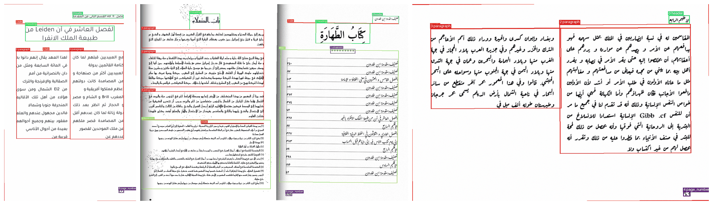

# synthetic-page-generator

Synthetic Arabic document pages with exact layout ground truth. Every block on
a page is placed by the generator, so every region's box, type and place in
the reading order is known by construction, not by annotation.



*Text: Ibn Khaldun's* Muqaddimah *(public domain, from Arabic Wikisource).
Typefaces: Google Fonts, SIL Open Font License.*

It draws the pages printed Arabic books are made of: body text in one to
three columns, footnote apparatus, glosses in the margin (*hashiya*), verse
set in two halves, headings and running heads, page numbers, tables and
indexes (*fahras*), figures, charts and maps, captions, stamps, ornaments,
calligraphy, title and imprint pages, and covers. It then scans them, with
skew, blur, noise, speckle, stains and gutter shadows, on white, tinted or
coloured paper.

## What you get

```
out/images/0000/s000000.png    the page
out/layout/0000/s000000.json   its regions, and the spec it was drawn from
out/manifest.json              every page, the region totals, any page that failed
```

Each region in the layout:

```json
{"id": 0, "bbox": [396, 115, 648, 178], "type": "heading", "score": 1.0,
 "native": "heading", "order": 0, "column": null,
 "quad": [[396.1, 114.8], [648.1, 115.2], [648.0, 178.2], [396.0, 177.8]]}
```

- **`bbox`:** `[x0, y0, x1, y1]` in pixels, origin top left.
- **`order`:** the reading order: columns right to left, top to bottom inside a
  column. Every region has one, figures and rules included.
- **`column`:** 0 for the rightmost column, which is read first; `null` for a
  region that spans the page.
- **`quad`:** when the page was scanned with a skew, the region's four corners,
  rotated with the page; `bbox` is then their bounding box. `null` on a page
  with no skew.

20 region types: `paragraph`, `text`, `footnote`, `hashiya`, `header`,
`footer`, `page_number`, `heading`, `verse`, `table`, `toc`, `figure`,
`chart`, `rule`, `ornament`, `stamp`, `caption`, `calligraphy`, `non_text`,
`other`.

`synthetic-pages-coco` writes the same pages as one COCO file, optionally
merging or dropping types through a class map (see below).

## Install

```bash
pip install "synthetic-page-generator @ git+https://github.com/g3ida/synthetic-page-generator.git"
```

Python 3.10+, with NumPy, SciPy, fontTools and Pillow. Pillow must have Raqm,
the text shaper, or Arabic letters are drawn unjoined; the PyPI wheels have it.

## Quick start

The generator needs **fonts** and **text**. Neither is bundled.

```bash
python tools/fetch_fonts.py fonts/                  # 36 open Arabic typefaces
python tools/make_text_pool.py book.txt -o pool.json
synthetic-pages --n 100 --text-pool pool.json --fonts fonts/ --out out/
synthetic-pages-coco out/
```

- **Fonts:** `tools/fetch_fonts.py` downloads the 36 typefaces the defaults were
  tuned on, from Google Fonts at a pinned commit, checked against their
  SHA-256 (Naskh, Kufi, Ruqaa, Nastaliq, Maghribi and modern sans). Any other
  Arabic `.ttf` or `.otf` works too. `--fonts` takes folders, glob patterns or
  files. A face whose file name contains `Nastaliq`, `Gulzar`, `ArefRuqaa`,
  `Qahiri` or `Alkalami` is also used for display and calligraphy.
- **Text:** every word comes from a text pool. The generator samples real
  passages and never invents text, so give it text in the register you want.
  [docs/TEXT_POOL.md](docs/TEXT_POOL.md) has the format;
  `tools/make_text_pool.py` builds one from plain text, with verse from a
  separate file if you have one.
- **Pictures** are optional. Without them a page that would have held one
  draws something else:

  | option | what it is |
  |---|---|
  | `--figures DIR` | photographs and illustrations, placed as figures |
  | `--cutouts DIR` | transparent PNG art, pasted with no frame |
  | `--dirt DIR` | transparent grime and dust overlays, laid over the page |
  | `--calligraphy DIR` | calligraphy pieces, set into the text as display text |

## Options

| | |
|---|---|
| `--n`, `--seed` | how many pages, and the seed. The same seed, inputs and version give the same pages, byte for byte. |
| `--profile train` | over-samples rare layouts (charts, three columns, glosses, rotated pages) so a detector sees enough of each. The default. |
| `--profile realistic` | the rates printed books actually have. |
| `--workers` | processes; all but one core by default |
| `--force '{"ncols": 2}'` | fix parts of the page spec (see `sample_spec` in `generator.py`) |

## A class map for COCO

A JSON object from generator type to class name; `null` or a missing type
drops it:

```json
{"paragraph": "text", "heading": "text", "verse": "text", "text": "text",
 "footnote": "footnote", "hashiya": "hashiya", "header": "header",
 "footer": "footer", "page_number": "page_number", "table": "table",
 "toc": "table", "caption": "caption", "figure": "figure", "chart": "figure"}
```

```bash
synthetic-pages-coco out/ --map classes.json -o out/coco.json
```

## From Python

```python
import json, random
from synthetic_page_generator import assets, build, sample_spec

assets.configure(fonts=["fonts/"])
pool = json.load(open("pool.json", encoding="utf-8"))
rng = random.Random(0)
image, regions, spec = build(pool, rng, sample_spec(rng))
```

`build` raises `BadPage` for a draw whose boxes contradict each other; the
command line redraws those.

## Tests

```bash
pip install -e ".[test]"
python tools/fetch_fonts.py fonts/
pytest
```

The end-to-end tests skip when no Arabic font is found (`fonts/`, the
`SPG_FONTS` variable, or a system Noto Naskh Arabic).

## Licence

Apache-2.0, see [LICENSE](LICENSE). The fonts `tools/fetch_fonts.py` downloads
are under the SIL Open Font License; their licences are saved beside them.
